<h1>
  <picture>
    <source media="(prefers-color-scheme: dark)" srcset="docs/brand/clink-wordmark-on-dark.svg">
    <source media="(prefers-color-scheme: light)" srcset="docs/brand/clink-wordmark-on-light.svg">
    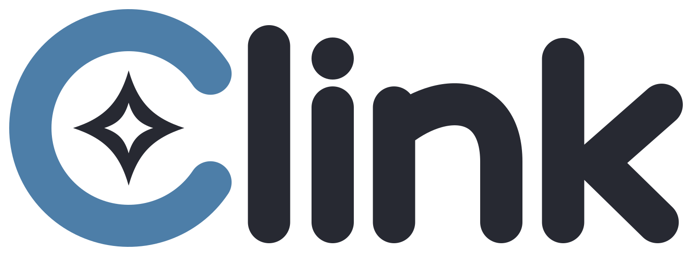
  </picture>
</h1>

A tiny Windows replay-buffer clipper for games. It keeps the last stretch of your screen and audio in memory (the
replay length is yours to set, 45 seconds by default); press a key, hear a click, and the clip is on disk. Share it to
[Copium](https://copium.pics) with one click and the link lands in your clipboard.

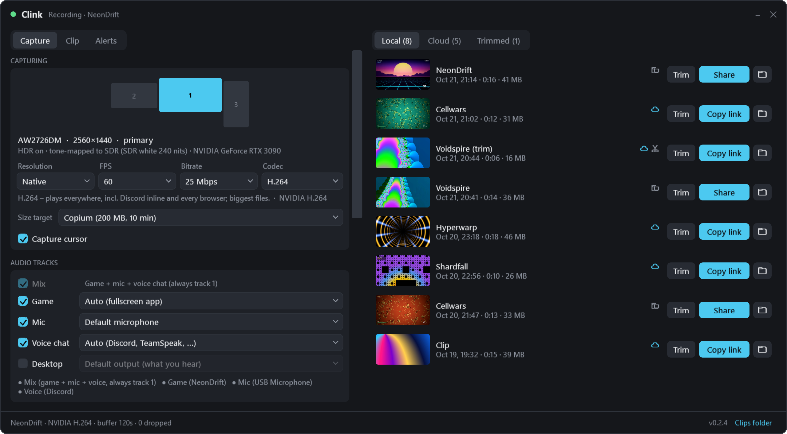
<sub>Recording a game: capture settings and audio tracks on the left, your clips on the right. More under
[Screenshots of Clink](#screenshots-of-clink); the screenshot tool itself is under [Taking screenshots](#taking-screenshots).</sub>

* Single `Clink.exe`, no installer, no background services. Needs the .NET 10 Desktop Runtime (Windows 10 2004+ / Windows 11; HDR and per-process audio need Windows 11).
* Captures with Windows Graphics Capture, so borderless **and** exclusive-fullscreen games work.
* **HDR done right**: on an HDR display it captures the FP16 scRGB frame and tone-maps it on the GPU using the
  display's SDR white level, so clips look like the game instead of grey and washed out.
* GPU-only pipeline: capture → compute-shader NV12 convert → NVENC/AMF/QuickSync H.264 (or HEVC, or AV1 where the
  GPU can). Frames never touch the CPU.
* Multi-track audio in every clip. Track 1 is always a **mix of game + mic + voice chat**, so Discord, browsers and
  every player that only plays the first track hear everything (it is also the only track marked as enabled, so
  QuickTime and iPhones do not play all of them at once). The parts are also saved as their own tracks, and the
  source of each is picked in the window:
  1. **Mix** – game + mic + voice, always first
  2. **Game** – only the game's own audio (Windows per-process capture). Auto-detects the fullscreen app on the captured
     monitor (or the game-library / custom app Clink detected, windowed or not), or pick a running app, or pick an audio device instead (a virtual input such as Wave Link's "Game", or the
     loopback of any output); falls back to "everything except your voice app" until a game is detected
  3. **Mic** – the default microphone (it follows Windows when you change the default device) or any other capture
     device
  4. **Voice chat** – Discord / TeamSpeak / Slack / Mumble / Zoom / Skype found automatically, any running app, or an audio
     device (off as a separate track by default; always part of the mix)
  5. **Desktop** (optional) – everything you hear from an output device (the default one follows Windows too), or an
     audio input (a Wave Link / VoiceMeeter mix, a virtual cable), as an extra track
* Click a clip to play it in Clink's own player; its **✂ Trim** switch turns it into the trim editor: cut start/end
  without re-encoding the video, set the volume of every audio track (the Game, Mic and Voice sliders also shape *All
  audio*, live), then save or save-and-share.
* **Records only while a game runs** (default) or always. Games are detected by a fullscreen/borderless window on the
  captured monitor, by living in a known game-library folder (Steam, Epic, Riot, Battle.net, Ubisoft, EA, GOG, Xbox,
  Rockstar), or by being on your custom-apps list; while nothing runs the capture, encoder and RAM buffer are stopped.
  Maximized apps and overlays (Game Bar, the NVIDIA overlay, PowerToys, widgets) do not count as games; borderless
  games that hide their frame (SDL3 games such as osu!lazer) do.
* **One main hotkey, and as many more as you like**: the main one (**Alt+C** by default) always saves the full replay;
  every other hotkey is a key combo plus what it does (a shorter clip, pause/resume, share last clip) and, for clips,
  how much to save (e.g. Shift+F9 = the last 15 s). While the game is in front a hotkey also fires with extra Ctrl /
  Alt / Shift held (crouch + Alt+C still clips); on the desktop only the exact combo does, so Ctrl+Alt+C in another
  program still reaches that program. An Alt combo does not light up the menu bar of the program in front: Clink sends a
  dummy key between the Alt press and release (never into a game: nothing synthetic is sent while the game is in front).
* **Never a silent miss**: if a clip cannot be saved (recording paused, still waiting for a game, the recorder failed,
  disk full) or a share cannot be uploaded, Clink says why where you are looking: a toast over the game, a tray balloon
  otherwise. With nothing recording you hear the Windows error sound instead of the click.
* **Recovers by itself**: a recorder that fails to start (encoder busy, monitor still waking up) is retried in the
  background, and after a graphics driver crash (TDR) Clink notices, says *The GPU was reset* and restarts capture on a
  fresh device. You are told once, not on every retry.
* **Replay length slider** from 5 s to 60 min (45 s by default), in the Capturing card with one readout under it: the
  **size** per minute and per clip of that length and the **RAM** the buffer costs, live; and **size targets** (None, the
  default; Discord 10 / 50 / 500 MB; Copium 200 MB / 10 min; Copium Plus 2 GB / 60 min) that lower the bitrate, only
  when needed, so a clip of that length fits.
* H.264 or HEVC, and AV1 (experimental) when the GPU has an AV1 encoder; codecs the GPU lacks are listed greyed out.
  H.264 stops at 4096 px, so a wider recording (a 5120×1440 super-ultrawide at *Native*) is made in HEVC, and the
  Capture tab says so.
* Toasts for *clip saved*, *shared* and *recording started*, each with its own switch, duration and a preview; eight
  positions on the captured monitor. Away from the window you also get short notices for *Uploading to Copium…*
  (share hotkey), *Recording paused / resumed* (pause hotkey) and anything that went wrong. Optional always-on **status dot** in a corner (green recording, amber waiting, red
  error, grey paused). Toasts, the dot and the Share window are hidden from screen capture, so they never end up in a clip.
* **Share without a Copium account**: with no token, Share opens a window with the clip's file to drag into Discord, a
  browser upload box or a folder (it is only ever copied, the clip stays in your library), or to copy and paste.
* Optional **archive**: clips land in the local folder first and move to a NAS share, mapped drive or any other folder
  in the background (slowly, oldest first, after N days and/or when the local folder is over N GB), or whenever you
  say so: *Archive now…* moves what is due, or every local clip, with progress and a result.
* Shows which monitor it is capturing; click another one on the little map to switch.
* **Sharing is opt-in.** Nothing is uploaded until you say yes once: the first time you share with a token saved (or press
  an *Upload* button), Clink asks *Share with Copium?* and warns that **anything you upload is immediately publicly
  accessible to anyone who has the link; links are not private and cannot be recalled by Clink**. *Not now* leaves it
  at that, *Enable Copium sharing* agrees (Enter never does: *Not now* is the default button), and *Don't ask again* only
  stops Clink asking on its own (sharing a clip or a screenshot yourself still asks until you say yes). Under
  *App → Cloud sharing* a **kill switch** turns every upload off at once, including one that is running, hides the
  sharing buttons and replaces the Copium section with a note; turning it back on is a two-step: a confirmation with the
  same warning. An importing copy of the settings can switch it off, never on.
* Resizable borderless UI, dark or light with six accent colours: settings tabs (Capture · Clips · Screenshots · Alerts ·
  App) with the clips pane beside them when the window is wide, as a last tab (Library) when it is narrow. *App →
  Features* switches **Clips** and **Screenshots** on or off, live; Clips off hides the Clips and Library tabs and the
  recorder's settings (Capture keeps only the hotkeys) and does not start the recorder, and the last feature that is on
  cannot be turned off. Lives in the tray while you play.

## Taking screenshots

A ShareX-style screenshot tool that lives next to the clip recorder (its own folder and history; a screenshot is never a clip).

* **Hotkeys**: <kbd>PrintScreen</kbd> takes a screenshot, <kbd>Shift</kbd>+<kbd>PrintScreen</kbd> reopens the last one in the
  editor (both are rows in Capture → Hotkeys, added once for you when the keys are free; change or delete them there). The
  tray menu and `Clink.exe --screenshot` / `--screenshot-edit-last` / `--screenshot-edit <file.png>` do the same.
  Press the hotkey again while choosing an area to cancel.
* **Choosing the area**: the screen freezes, you drag a rectangle (any monitor, mixed DPI, even across monitors) with a
  magnifier at the pointer; <kbd>Enter</kbd> takes the whole monitor, <kbd>Esc</kbd> or a right click cancels.
* **After capture** (Screenshots tab): *Save only* (the default: it is saved and put on the clipboard at once, and the
  notification has Open / Edit / Folder buttons, and Upload when no automatic upload follows), *Open editor* (edit in a window, Done saves), or *Edit on screen*
  (draw right on the chosen area, Enter or Done saves, Esc steps back and then throws it away).
* **Editor tools**: select/move/resize, pen, line, arrow, freehand arrow, rectangle, text, crop, blur, pixelate, highlight,
  spotlight, magnify, smart erase, insert image (file, clipboard or a recent screenshot), brightness / contrast / sharpness;
  undo and redo for everything. Edit-last saves a new file and leaves the original alone.
* **Copium upload** is opt-in and off by default: a saved screenshot is only ever uploaded when you press the
  notification's *Upload* button, or after you switch on *Upload every screenshot to Copium automatically* in the
  Screenshots tab (or tick *Also upload every screenshot I take automatically* in the *Share with Copium?* pop-up). The
  token goes under *App → Copium* (shown only with cloud sharing on), and the first upload asks you to agree (see *Sharing is opt-in*
  above). An automatic upload needs the setting, your yes, cloud sharing on and a token; its link replaces the image on
  the clipboard when nothing else was copied meanwhile (*Copy the link to the clipboard after uploading*), and the
  *Uploading…* notification has a *Cancel* button. The file is **always saved locally first**, so a failed upload loses
  nothing. After your second screenshot on an install without a yes, up to two pop-ups, at least a day apart, may offer
  sharing (never over a game or a full-screen application; *Don't ask again* stops them). If Copium turns a picture down (HTTP 415, or a 400 about the
  type) or rejects the token (401, or a 403 about the token or with no reason), automatic uploads pause (until Clink
  restarts, or the token is changed) and the notification's *Upload* button still tries. The notification's buttons are
  *Open | Edit | Upload or Copy link | Folder*; *Upload* shows when a token is set, cloud sharing is on and no automatic
  upload follows.
* **Settings**: folder (default `Screenshots` inside the clips folder), copy image to clipboard, magnifier, after-capture mode,
  upload options. Files are named `Game yyyy-MM-dd HH-mm-ss.png` (the game only while it is being recorded).

## Screenshots of Clink

<table>
<tr>
<td width="50%"><a href="docs/screenshots/capture-audio.png">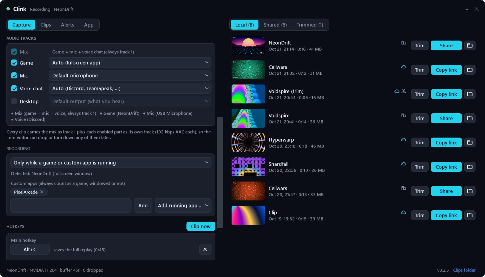</a><br><sub>Audio tracks: a source per track, and what each one is capturing right now. Below, the recording mode and custom apps.</sub></td>
<td width="50%"><a href="docs/screenshots/replay-length.png">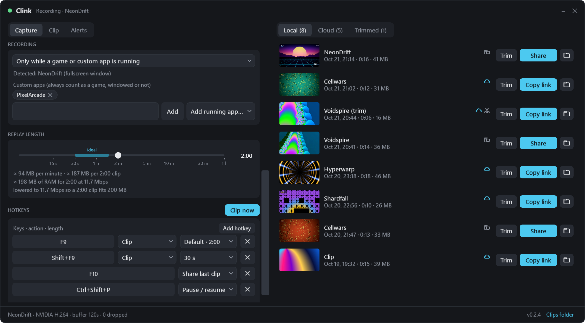</a><br><sub>Replay length, under the size target in the Capturing card, with the size / RAM readout and what the size target did.</sub></td>
</tr>
<tr>
<td><a href="docs/screenshots/hotkeys.png">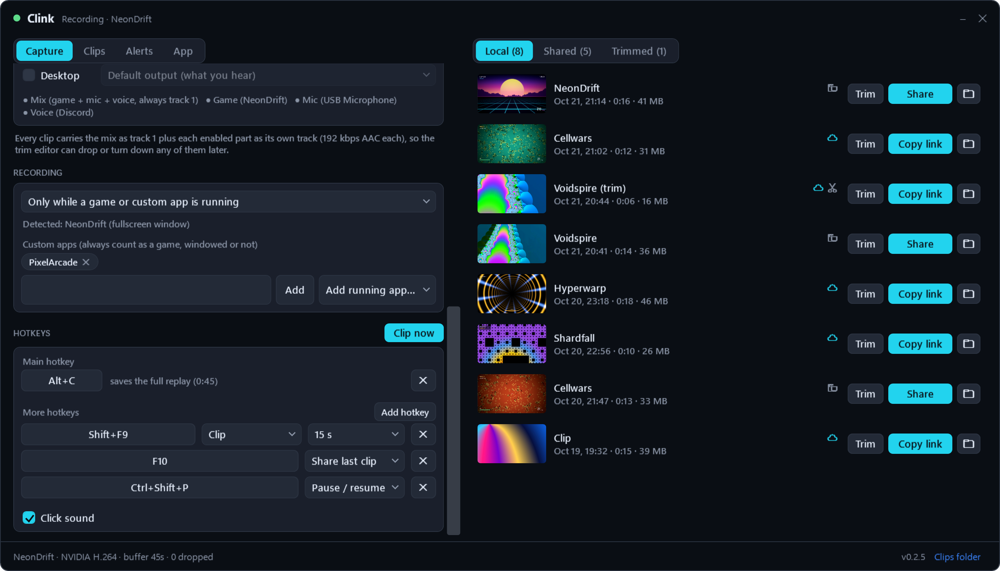</a><br><sub>Hotkeys: the main hotkey always saves the full replay; more hotkeys add shorter clips, share-last and pause / resume.</sub></td>
<td><a href="docs/screenshots/clip-tab.png">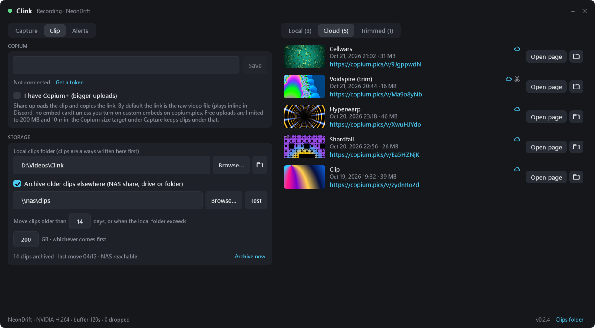</a><br><sub>App tab: the Copium token and the storage settings, with <i>Archive now…</i>. Right: everything you shared, with its link.</sub></td>
</tr>
<tr>
<td><a href="docs/screenshots/alerts-tab.png">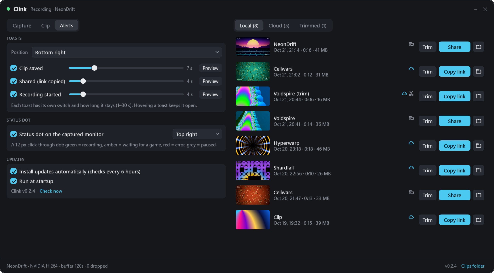</a><br><sub>Alerts tab: toasts and the status dot.</sub></td>
<td><a href="docs/screenshots/app-tab.png">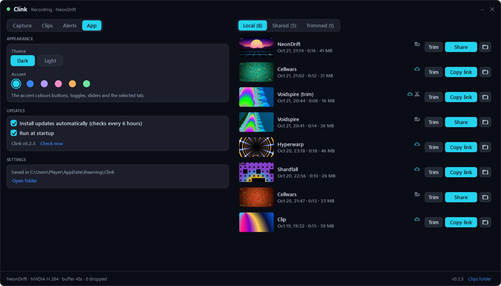</a><br><sub>App tab: theme and accent, updates and run at startup, and where the settings are kept.</sub></td>
</tr>
<tr>
<td><a href="docs/screenshots/app-tab-light.png">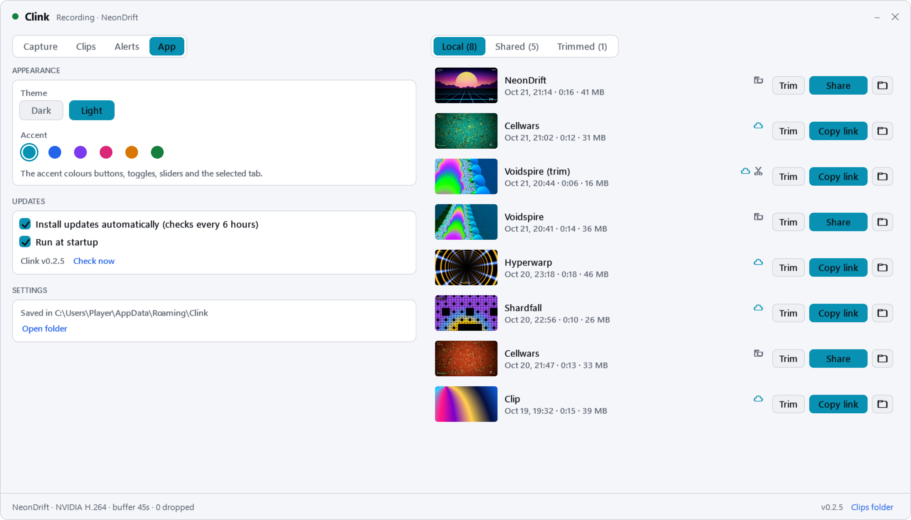</a><br><sub>The same tab in the light theme: every window repaints at once, an open player or toast included.</sub></td>
<td><a href="docs/screenshots/narrow.png">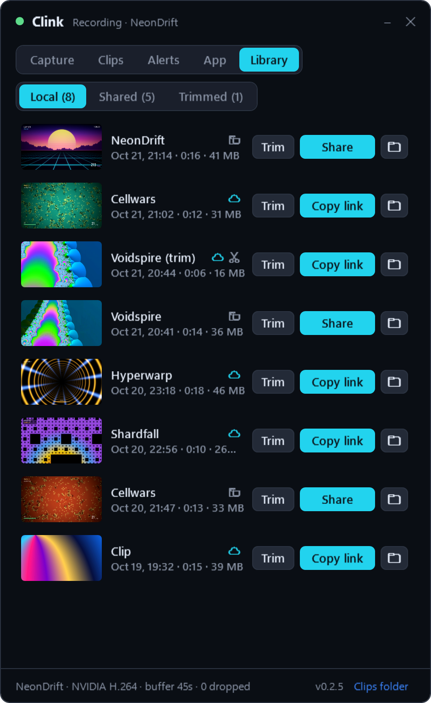</a><br><sub>Narrow window: the clip list becomes the Library tab.</sub></td>
</tr>
<tr>
<td><a href="docs/screenshots/player.png">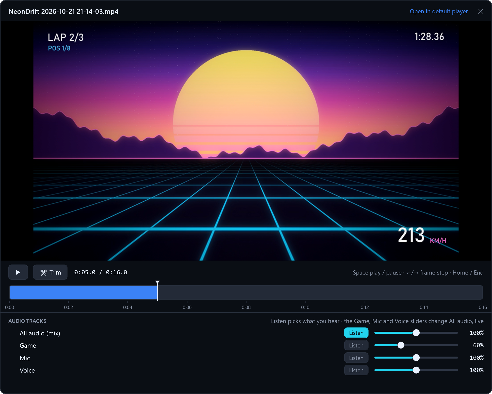</a><br><sub>Player (a click on a clip): a seek bar, and a Listen pill and volume for every audio track; Game, Mic and Voice change <i>All audio</i>, live.</sub></td>
<td><a href="docs/screenshots/trim-editor.png">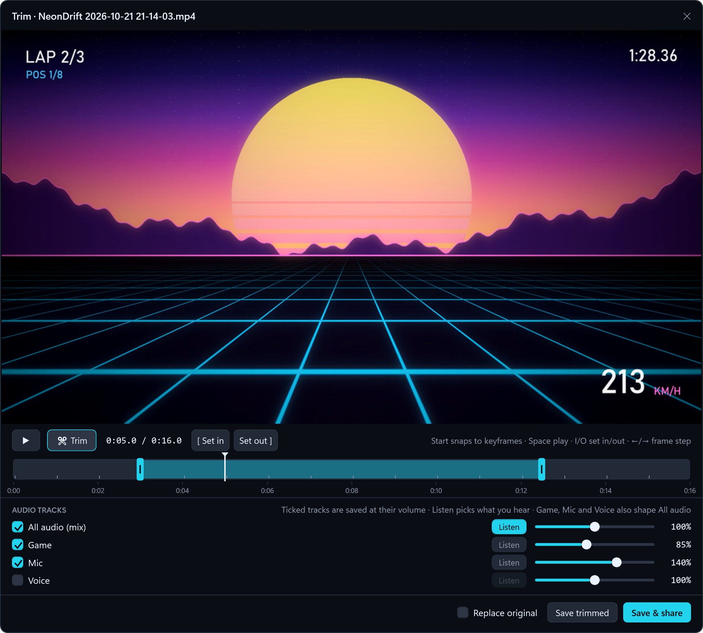</a><br><sub>Trim editor (the <i>✂ Trim</i> switch): in / out on the timeline, per-track include and volume, Save or Save &amp; share.</sub></td>
</tr>
<tr>
<td><a href="docs/screenshots/trimmed-tab.png">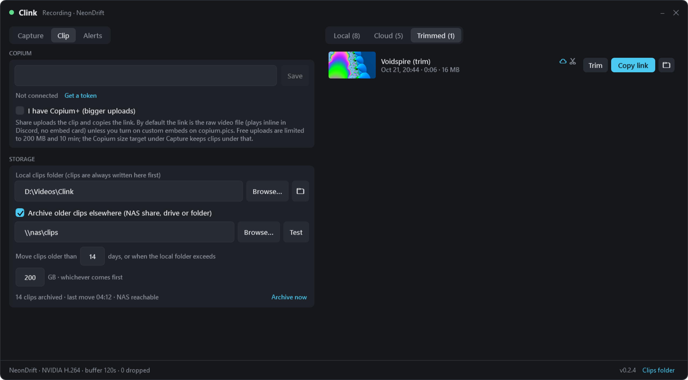</a><br><sub>Trimmed: the cuts the trim editor saved next to their originals, with Trim / Share / folder like any clip.</sub></td>
<td><a href="docs/screenshots/share-window.png">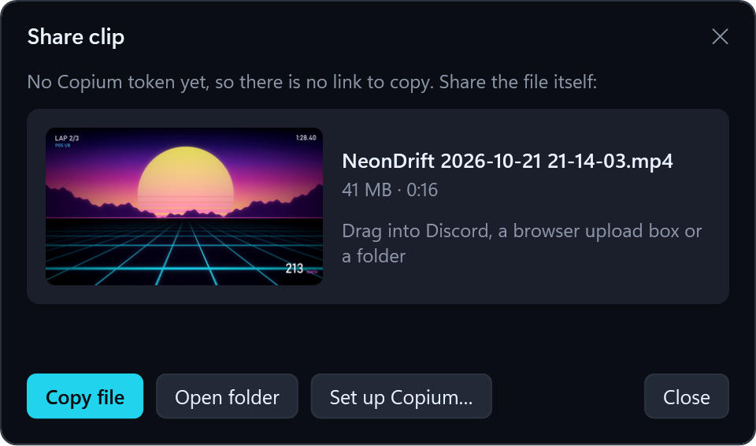</a><br><sub>Share without a Copium token: drag the file into Discord, a browser upload box or a folder, or copy it.</sub></td>
</tr>
<tr>
<td><a href="docs/screenshots/archive-window.png">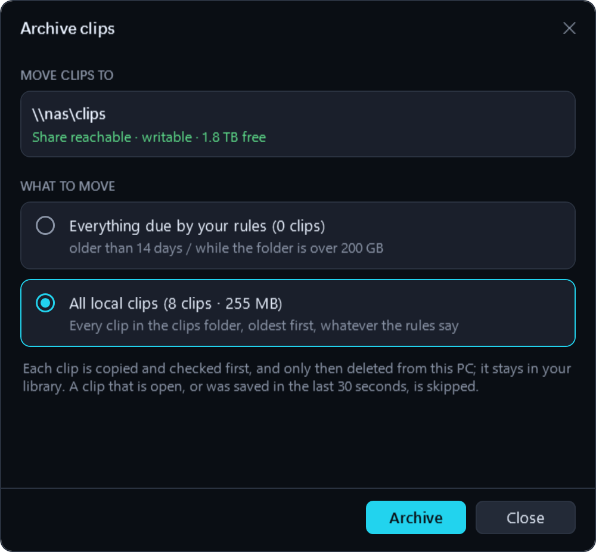</a><br><sub><i>Archive now…</i>: everything due by your rules, or every local clip, then progress and a result.</sub></td>
<td><a href="docs/screenshots/toast.png">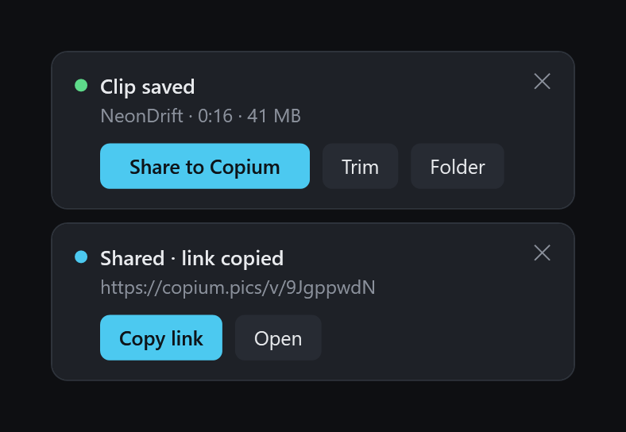</a><br><sub>Toasts: <i>Clip saved</i> with Share / Trim / Folder, and <i>Shared · link copied</i>.</sub></td>
</tr>
<tr>
<td><a href="docs/screenshots/notices.png">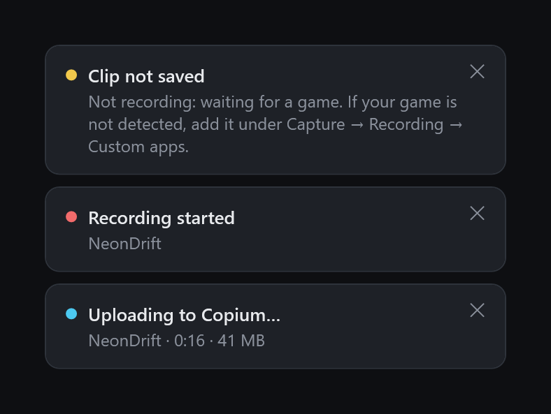</a><br><sub>Notices away from the window: <i>Clip not saved</i> and why, <i>Recording started</i>, and the share hotkey's <i>Uploading to Copium…</i></sub></td>
<td><a href="docs/screenshots/in-game.jpg">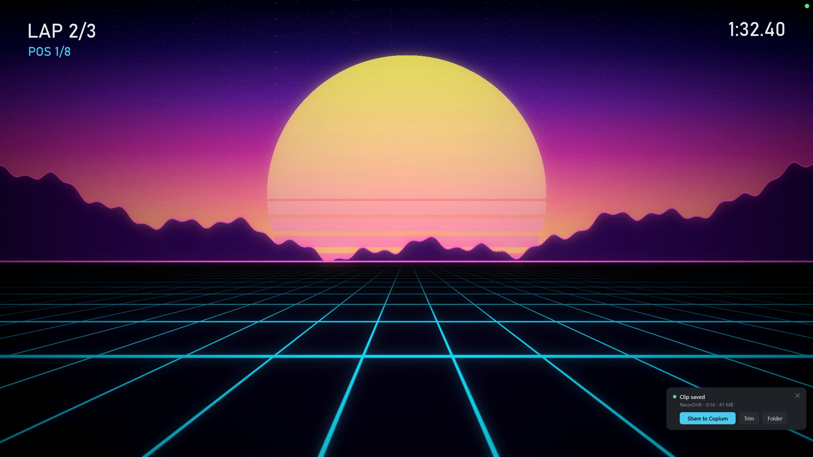</a><br><sub>In game: the <i>Clip saved</i> toast and the green status dot (top right) where Clink puts them. Both are hidden from screen capture, so they never end up in your clips.</sub></td>
</tr>
</table>

All screenshots are of Clink itself (the dark theme with the default accent unless a caption says otherwise), rendered from synthetic clips (no real games or accounts). They predate the Euphoric Software rebrand and show the earlier cyan palette.

## Installing & updating

1. Download `Clink.exe` from the [Releases](../../releases/latest) page. Put it anywhere (Desktop, `C:\Tools`, a
   USB stick) and run it. There is no installer; settings live in `%APPDATA%\Clink`, downloaded updates in
   `%LOCALAPPDATA%\Clink`.
2. It needs the [.NET 10 Desktop Runtime](https://dotnet.microsoft.com/download/dotnet/10.0). If it is missing,
   Windows shows a dialog with the download link on first run.
3. The exe is not code-signed (yet, see [ROADMAP.md](ROADMAP.md)), so SmartScreen may show "Windows protected your
   PC" the first time: *More info* → *Run anyway*. After that it does not ask again for that file.

**Updates are automatic.** Clink checks [GitHub Releases](../../releases) when it starts and every 6 hours after
that. When a newer version exists it downloads the new `Clink.exe` to `%LOCALAPPDATA%\Clink\updates`, checks it
against the `Clink.exe.sha256` published with the release (this catches a corrupted download; it does not prove who
built the file, which is what code signing is for, see [ROADMAP.md](ROADMAP.md)), and installs it the next time
Clink starts, so a recording session is never interrupted. The footer and the tray menu show **Update to vX.Y.Z** to
install it right away instead. Before installing, the file is hashed again against what was verified, and the exe is
swapped in by renaming with the previous `Clink.exe` kept as `Clink.exe.bak` until the new one has started, so a
failed install never leaves you without a working Clink: a new exe that does not start is swapped back, and that
download is not tried again on every start. If an update cannot be installed (for example `Clink.exe`
lives in a folder you cannot write to, or Clink runs as administrator) Clink says so in the footer, in a tray message
and under *App → Updates*, and leaves the download in `%LOCALAPPDATA%\Clink\updates` to install by hand. *App →
Updates* also shows *Last check failed: …* when GitHub could not be reached (it gives up after 30 s) and *Update
problem: …* when a download failed. To turn auto-update off, untick *Install updates automatically* under *App →
Updates*; this takes effect at once (no restart), Clink then never contacts GitHub on its own, and *Check now* (or
*Check for updates* in the popup that clicking the version in the footer opens) checks by hand and opens the release
page if there is something newer.

**Dev builds.** Every push to the `dev` branch publishes a GitHub *prerelease* named `vX.Y.Z-dev.N` (workflow
`release-dev.yml`, only after the unit tests pass; the 10 newest are kept). Clink ignores them unless you tick *Dev
Build* in the popup that opens when you click the version in the footer: it then follows the newest of the latest
release and the dev builds, and installs it like any update. Dev builds may be unstable. Untick *Dev Build* and
Clink goes back to releases: unticking checks for updates right away, and from a dev build that is newer than the
latest release this switches back to that release (with auto-update on, the release is downloaded and installed at
the next start, or at once with *Update to v…*; *Check for updates* does the same later). The background checks
never go back to an older release on their own. A dev build downloaded before you unticked the box is never
installed on the release channel. The choice is kept in `UseDevBuilds` in
`settings.json`, per installation (an import never changes it).

## Using it

1. Run `Clink.exe`. The header says *Waiting for a game…* until a game or custom app starts, then *Recording · Overwatch*
   (switch to *Always* under *Capture → Recording* to record whatever is on the monitor, as before).
2. Press **Alt+C**, the main hotkey (or any other hotkey from your list under *Capture → Hotkeys*), while gaming. It saves
   the full replay, 45 s by default. You hear a short click; the clip is saved to `Videos\Clink\<game> <date>.mp4` and a
   small "Clip saved" toast appears. If nothing was recording you hear the Windows error sound instead and a *Clip not
   saved* notice says why (paused, waiting for a game: add it under *Custom apps*, or the recorder's error); a save that
   fails (disk full) says so the same way. The file is written under a temporary name and renamed when complete, so a
   failed save never leaves a broken clip behind. Clink eats the main hotkey while it runs (it is a global hook), so a
   program that uses Alt+C itself loses it; pick other keys under *Capture → Hotkeys* if that matters. A file from
   before v0.2.5 with no hotkey for the full replay gets Alt+C for it (left unset when another hotkey already uses
   Alt+C) and says so once, in the footer and a tray balloon.
3. Click **Share** (in the toast, the clip list or the trim editor). The first time with a token saved, Clink asks
   *Share with Copium?* (see *Sharing is opt-in*); after *Enable Copium sharing* the clip is uploaded to Copium and the link is
   copied. With cloud sharing off nothing is uploaded and the Share buttons are hidden (a clip that already has a link
   can still have it copied). The share hotkey over a game does not open the pop-up: it says *Sharing needs your OK once - open Clink and press Share*. By default the copied link is the raw video file, so pasting it in Discord plays the video inline with no
   embed card. If you turn on custom embeds on copium.pics, Copium's `link` becomes the share page instead; Clink
   just uses whatever Copium says to copy. A clip is uploaded once: pressing Share again (or the share hotkey) while
   it uploads waits for that upload. When an upload fails the toast and the clip row say why (*Copium rejected the
   token (…)*, *Copium is having trouble (HTTP 502), try again later*, *Can't reach Copium - check your connection*, …).
   **Without a Copium token** Share does not fail: it opens the **Share window** with the clip's file as a card (its
   thumbnail, name and *size · length*; the length appears only when it is known). Drag the card into
   Discord, a browser upload box or an Explorer folder (the file is only ever copied, so the clip stays in your library),
   or press *Copy file* and paste with Ctrl+V; *Open folder* shows it in Explorer and *Set up Copium…* brings Clink's
   window forward (the footer says where the token goes: *App → Copium*). The window floats above other windows so it
   stays in reach while you bring the drop target forward, but goes behind a game that has the focus (and, opened over a
   game, appears at the toast position without taking the focus); it is hidden from screen capture like the toasts and
   shows no file path. The share hotkey (or `--share-last`) opens no window over a game or any other full-screen
   application: a toast says *No Copium token: open Clink to share the file*. A clip in the archive is looked up first,
   so an offline NAS never freezes the window.
4. Click a clip (its row or its thumbnail) to play it in Clink's own **player**: the preview, play / pause (Space), a
   seek bar, ←/→ to step a frame, Home / End, and a row for every audio track with a Listen pill (the track you hear)
   and a volume slider; *Open in default player* (top right) hands the file to your system's player. The **✂ Trim**
   switch next to Play turns the same window into the **trim editor**, and back, without losing anything: drag the in/out
   handles (or press I / O at the playhead), and tick which tracks to keep. Every audio track has its own include
   toggle and volume, which you hear in the preview and which are baked into the saved file. **All audio** (the mix,
   track 1) follows the **Game, Mic and Voice sliders**: it is rebuilt from those tracks, live in the preview and in the
   saved file, and with every slider at 100 % the baked mix is used untouched. A source's include box only decides
   whether its own track is saved; its slider always shapes All audio. Desktop is never part of All audio. Voice is not
   saved as a track of its own by default, so it is only inside All audio: its volume cannot be changed there, and
   turning Game or Mic down takes it out of the baked mix again, which can leave a faint trace of it (tick *Voice chat*
   under *Capture → Audio tracks* to keep it as a track). Taking a source out of the mix only cancels when the tracks
   are in step to the sample: a recording of this version and a trim of one keep every track's place exactly (the file
   says so with a `clk1` brand in its `ftyp`), but every clip without that mark (recorded or trimmed before v0.2.5)
   may not have kept how its tracks sat against each other, so the editor lines each source up with the Mix by
   cross-correlation, and when it cannot find one it says *Recorded or trimmed by an older Clink: sources cannot be
   changed inside All audio*: that source's slider then changes only its own track (`--trim` prints the same note and
   does the same). Clink reads its clips with the audio tracks' edit lists hidden from Media Foundation (it applies
   them on Windows Server 2025 and ignores them on Windows 11), so every track starts at 0 on every Windows and Clink
   puts it where the file says; a check made once per run on a small probe clip (the log's `media:` line says what
   Media Foundation does) makes sure that holds, and on a Windows where it does not the editor says *This Windows
   reads clips differently: sources cannot be changed inside All audio*, no cut is marked `clk1` and All audio is not
   rebuilt. The in point snaps to a keyframe (every second by default) so
   the cut is exact in every player, and the export copies the video without re-encoding. *Save trimmed* writes
   `<clip> (trim).mp4` next to the original (tick *Replace original* to replace the clip with the cut instead), or
   *Save & share*. The *Trim* button on a clip row, the toast's *Trim* and `--trim-last` open the editor directly; a
   second click on a clip that is already open brings its window forward.

Copium: make an upload token under *ShareX & API* on copium.pics (it starts with `eup_`) and paste it in the
Copium box (*App → Copium*, under *Cloud sharing*). It is stored encrypted for your Windows user (DPAPI). Nothing is uploaded
unless you press Share (or Upload) and have agreed in the *Share with Copium?* pop-up (or you opted in to automatic screenshot uploads: *Upload every screenshot to Copium automatically*, which also needs that yes); saving a token asks once when you have not. Share checks a clip against the limits of the account you say you have: without Copium+ an upload may be at most
**200 MB and 10 minutes** long, with Copium+ (tick *I have Copium+*) **2 GB and 60 minutes**. A clip over the limit is not
uploaded; Share says so (*Over Copium's free limit (200 MB / 10 min)*, *Over Copium Plus's limit (2 GB / 60 min)*; the footer
adds how big the clip is and what to do: trim it, or tick *I have Copium+* if you have it) and the toast's button reads
*Over free limit* / *Over Plus limit*. The *Copium (200 MB, 10 min)* and *Copium Plus (2 GB, 60 min)* size targets keep
clips of the replay length (or of the length limit, when the replay length is longer) under the size limit; picking
Copium Plus also ticks *I have Copium+*. The toast's button reads *Share* without a token, *Share to Copium* with one and
*Copy link* once the clip is shared. Sizes of clips and limits are shown in decimal MB, the unit the limits use.

### The window

* **Capture**, top to bottom: **Capturing** - the monitor map, resolution / FPS / bitrate / codec with a one-line
  description of each codec (the ones your GPU cannot encode are greyed out; the 1440p / 1080p / 720p presets name the
  short side, so a portrait 1080×1920 monitor at 1080p records 1080×1920), the **size target** (*None*, the default;
  *Discord 10 MB*; *Nitro Basic 50 MB*; *Copium 200 MB, 10 min*; *Nitro 500 MB*; *Copium Plus 2 GB, 60 min*: when a clip
  of the replay length would not fit, the encode bitrate is lowered just enough, audio tracks included; it is never
  raised above the bitrate you chose; picking Copium Plus also ticks *I have Copium+*), the **replay length** slider
  (the 30–90 s stretch is the sweet spot) with the one size/RAM readout right under it, recomputed on every resolution,
  FPS, bitrate, codec, size-target, audio-track or length change, and *Capture cursor*. The readout's figures are
  bitrate × audio tracks × length (resolution and codec decide how good a clip looks at that bitrate, not how big it is):
  *≈ 154 MB per minute · ≈ 116 MB per 45 s clip* (20 Mbps, three tracks; at 1 h the clip figure becomes the per-hour
  figure), *≈ 132 MB of RAM for 45 s at 20 Mbps* (red above half of your RAM; the slider refuses lengths that could not
  be allocated at all) and what the size target did, in yellow when no bitrate can make the clip fit or when the replay
  length reaches the target's own limit (Copium's 10 minutes, Copium Plus's 60) - the target then fits a clip of that
  length, not the whole replay, since a longer clip has to be trimmed before Share anyway; **Audio tracks** - the
  per-track rows with their source pickers (a *Set up your audio* banner sits above them until you rest the pointer on
  the group for a moment or change an option; it goes when the pointer leaves the group, so nothing jumps under it, and
  does not come back) and under them what each track is capturing right now or why it is not (*● Mic (USB
  Microphone)*, *○ Voice (waiting for app)*); **Recording** - the recording mode and the custom-apps list (type an exe
  name or pick one of the apps running right now); **Hotkeys** - the *Main hotkey* (click the keys box, press the combo;
  Esc cancels; *Clear* empties it) with *saves the full replay (0:45)* beside it, which follows the replay length: the main
  hotkey always saves the full replay and can be cleared, not removed. Under *More hotkeys* every other one has its keys,
  an action (*Clip*, *Pause / resume*, *Share last clip*) and, for a clip, a fixed length shorter than the replay length
  (5 s up to the longest step below it; a saved length at or above the replay length reads *(capped to replay)* and counts
  again once the replay is longer); *Add hotkey* adds a clip row on 30, 15, 10 or 5 s, whichever is the longest below the
  replay length. *Clip now* sits in the header (it saves the full replay) and the click sound under the list. A combo
  another row already has (the main one included), or a bare letter, digit or editing key (it would be eaten in every
  program), is refused with a hint and the box keeps listening; F-keys, ScrollLock and Pause work alone.
* **Clips** (only with the Clips feature on): **Storage** - the local clips folder, the archive location (*Browse…*,
  *Test*, *Archive now…*) and *Move clips there automatically* with its rules (below).
* **Screenshots** (only with the Screenshots feature on): the folder, clipboard and magnifier options, *After capture*, and the
  opt-in upload options.
* **Alerts**: **Toasts** - the position and the four toast switches (Clip saved, Shared, Recording started, Screenshot saved) with their durations and a *Preview* button each;
  **Status dot** - the dot and its corner.
* **App**: **Features** - *Clips* and *Screenshots* on or off; **Cloud sharing** - the kill switch (off at once, on only after a
  confirmation); **Copium** - the upload token, its status, *Get a token* and the *I have Copium+* switch (replaced by a
  note while cloud sharing is off); **Appearance** - *Dark* or *Light* and one of six accents (Spark Blue, the default; Blue, Violet, Pink, Orange,
  Green), applied at once to every window that is open; **Updates** - auto-update, *Run at startup*, the version and
  *Check now*; **Settings** - where `settings.json` is kept, with an *Open folder* link, and, when they apply, the banners
  about a private copy of AppData and about settings another copy of Clink saved (see [Settings](#settings)).
* **Library** (the clips pane: a right pane when the window is at least 900 px wide, otherwise the last tab): **Local**
  lists every file with small icons (cloud = shared, scissors = trimmed, PC = local only, drive = archived) and Trim /
  Share / folder buttons; **Shared** lists everything you shared to Copium with the link (click = copy), *Open page* and
  the local file if it still exists, and keeps entries whose local file is gone; **Trimmed** lists the cuts made by the
  trim editor. A click on a clip (its row or thumbnail) plays it in the player.
* The footer shows the game, encoder, buffer and dropped frames, or the latest notice (hover it for the full text). The
  mouse wheel scrolls the page even over a closed dropdown, so scrolling never changes a setting by accident.

### Archive (NAS, second drive)

Clips are always written to the local clips folder first. Under *Clips → Storage* you can set an archive location:
a UNC share (`\\nas\clips`), a mapped drive or any folder. Sign in to a share once in Explorer; Clink never asks for
credentials, and on *access denied* the status line tells you to do exactly that. *Test* checks that it is reachable and
writable and shows the free space. Two things can then move clips there. By hand, *Archive now…* (below). Automatically,
once you tick *Move clips there automatically*: the rules under it are *older than N days* and/or *while the local
folder is over N GB*, whichever comes first (0 = off), and apply only while that is ticked. A background thread at the
lowest priority then copies eligible clips oldest-first in small chunks with pauses in between (it never competes with
the game), verifies the copy, deletes the local file and points the library entry at the archive, so Trim, Share and
thumbnails keep working from there; a clip that is open (uploading, trimming, playing) is skipped (when the size rule is
what makes clips due and the oldest one is open, the next one is taken instead: the folder only counts as smaller once a
clip has really moved), an unreachable archive is retried on the next run (1 min after a clip is saved and every 5
min), and a local file is never deleted before its copy was verified. Every move is logged. With the switch off and a
location set the status line reads *Automatic moves off · Archive now… moves clips by hand*.

**A clip is only ever deleted while a different, complete copy of it exists.** Right before the local file goes, Clink
holds the archive copy open and opens the clip with delete access, checks the clip through that handle (its length and
last write time, and that it is not the archive copy's own file) and deletes it through that handle, never by name. If
the archive location turns out to be the clips folder under another name (a junction, a second share of the same disk,
the `\\?\` spelling), the two names cannot be opened both ways at once, so that clip is skipped and never deleted; and a
trim that moves the clip aside and puts its cut in its place cannot lose the cut to a delete by name. Beyond that, *Test*,
the dialog and the automatic pass refuse a location that is the clips folder under another name (*Archive location is the
clips folder under another name: pick another folder, share or drive*): a small file is written into the archive and must
not show up in the clips folder, and the other way round (before every manual run and before the first move of an
automatic pass, once per location; it leaves no file behind). A clip that is a symbolic link is left alone.

**Archive now…** opens the *Archive clips* dialog. It shows where clips go and whether that works (*Share reachable ·
writable · 1.8 TB free*) and offers two things to move, with counts and sizes: *Everything due by your rules* (the rule in
words, *older than 1 day / while the folder is over 100 GB*; disabled when no rule is set) and *All local clips* (every
clip still in the clips folder, oldest first, whatever the rules say; preselected when nothing is due, which is what you
want when the folder is under its limit and the clips are young). *Archive* moves them the way the background job does
(copy, verify the length, delete the local file, point the library at the archive) with a progress bar and *Moving 3 of
12 · Copying clip.mp4 (40 %)*; *Cancel*, or closing the window, stops after the chunk being copied, deletes the partial
copy and leaves the local clip (clips already moved stay moved). A line at the end says what happened (*Moved 12 clips
(3.4 GB) to T:\clips · 1 in use, try again later*, *Archive unreachable*, *Moved 2 clips (…) · 3 failed: archive is full
(1 MB free)*, …). A clip that is open, changed while it was copied or before its delete, not deletable yet (a sharing or
lock violation), or was saved less than 30 s ago is left alone and counted as *in use, try again later*, and a later run
takes it. Anything that waiting does not fix is a *failure* with its reason (*3 failed: cannot delete the local clip:
access denied (is it read-only?)*): a clip that may not be read, one that may not be deleted (the verified copy stays and
the next run finishes the move), a copy that came out short, an archive copy that is missing or another length, a link.
It needs only a location, not the automatic switch and not a rule, and runs at full speed unless a game is detected, in
which case it keeps the gentle pace of the automatic moves (about 60 MB/s); the pace is asked for again for every chunk,
so a game that starts or ends during a long run slows or speeds the copy.

The path must be a full one (`D:\Clips`, `\\nas\clips`); a relative path (`\nas\clips`, a lost backslash) is refused
with a hint, and *Test* then says why instead of testing the previous path. Before each copy Clink checks the free space:
a clip that does not fit is skipped without writing anything, and an archive that is full, read-only or denies access
ends the run with a status line that says which (*archive is full (12 GB free)*, *archive is read-only*, *access denied:
open the share in Explorer once to sign in*) instead of trying every clip again. Pointing the archive elsewhere stops a
run in progress, and so does turning the automatic moves off (for an automatic run); a manual run also stops on *Cancel*
or when its dialog is closed, and the partial copy is deleted each time. A path typed into the box is accepted, or refused
with its reason, before the dialog opens (only a refusal that click caused stops it: one from an earlier tab or click
elsewhere does not eat the click, and the dialog names its destination). In the clip list an archived clip whose share is
offline says *archive offline* at once (Trim, play and folder do not wait out the network timeout) and clears itself when
the share is back; a clip that was deleted from the archive drops out of the list, or, if you shared it, stays under
**Shared** marked *deleted from the archive*.

### Stream Deck

Two ways, no plugin needed:

* Add a **Hotkey** action that sends one of Clink's hotkeys (Alt+C by default; a second binding with a shorter length
  makes a good second button). Clink uses a low-level keyboard hook, so it sees injected keys even when a game has focus.
* Or use a **System → Open** action with `Clink.exe --clip`. If Clink is already running this just tells it to
  clip and exits. `Clink.exe --trim-last` opens the trim editor on the newest clip and `Clink.exe --share-last`
  uploads it (or copies its link) the same way. If Clink is not running, these start it in the tray and then run the
  command; a `--clip` then only says there was nothing to save yet, since nothing was recording.
* A multi-action "clip, then share" (`--clip`, then `--share-last`) shares the clip just made: the share waits for the
  save, however long it takes, and if that clip could not be saved nothing is shared (never the clip before it).

Other commands: `--show`, `--minimized` (start in the tray), `--no-update` (start without installing a downloaded
update, handy for a debug build), `--selftest [seconds] [folder] [--codec h264|hevc|av1] [--quiet]` (records headless
and writes a clip to that folder, the clips folder by default, and prints what it did),
`--probe <file.mp4> [frame.png] [seconds] [--levels]` (stream timing report, for a Clink clip with its audio as Media
Foundation reads it and again as Clink does, with the edit lists hidden; optional decoded frame; `--levels` also
prints the RMS and peak level of every audio track),
`--trim <in> <out> <start> <end> [--gain Name=value]... [--drop Name]...` (the editor's cut without the window:
`--gain Game=0.5` or `Game=50%` sets a track's volume the way its slider does, so Game, Mic and Voice shape All audio as
well, and `--drop Voice` leaves a track out; the names are the file's own: Mix, Game, Mic, Voice, Desktop). The last
three can run next to a running Clink, and so can `--unittest` (see [Testing](#testing)). The hidden `--after-pid <pid>`
is Clink's own: it puts it on the command line of the Clink it restarts into (after an import or an update), and that
one waits for the old process to end, at most 10 s, before it takes the single-instance mutex.

### Settings

`%APPDATA%\Clink\settings.json` (the UI writes it; *App → Settings* says where it is and has an *Open folder* link). It
and the clip index `clips.json` are replaced in one rename on every save and keep the previous version as `.bak`, which
is read when the file is damaged. Hand edits may use `//` comments, trailing commas and numbers in quotes. Loading is
forgiving: a value of the wrong kind (`"Fps": "sixty"`, `"BufferSeconds": [1]`) keeps its default and costs nothing else
(Clink says at start which settings it could not read and keeps the original as `settings.json.unreadable` before it
saves); a hotkey row that cannot be read costs only that row (*left out hotkey row 2 (unreadable)*) and the others are
kept; a hand edit that does not parse at all is kept as `settings.json.unreadable` too, and Clink starts from the
`.bak` and says so; keys this version does not know (written by a newer Clink) are kept and written back, inside
hotkeys and toast settings too, so going back and forth between versions loses nothing; and a NaN or infinite number
(an earlier version wrote them as text) is put back to its default when settings are loaded, so it never reaches the
encoder, and again before every save, instead of making a save fail.

The file carries a `SchemaVersion`: **3** since v0.2.5 (a file without one counts as 2 when it has `Hotkeys`, else 1; an
older file is saved once, at start, in the new layout, and that save keeps the old file once as `settings.pre-v3.json`).
An existing file keeps every value it has: a default only fills in a key the file does not have, so an update never
changes what you chose (a v0.1 file never had `SizeTarget`, so it now starts on `none`, not `copium200`). What a fresh
install starts with:

| setting | key | fresh-install default |
|---------|-----|-----------------------|
| Resolution | `Resolution` | `1080p` (also `native`, `1440p`, `720p`) |
| FPS | `Fps` | 60 |
| Bitrate | `BitrateMbps` | 20 |
| Codec | `Codec` | `h264` (also `hevc`, `av1`) |
| Size target | `SizeTarget` | `none` |
| Capture cursor | `CaptureCursor` | true |
| Recording | `RecordingMode` | `game`: only while a game or custom app runs |
| Replay length | `BufferSeconds` | 45 |
| Main hotkey | `Hotkeys[0]` | Alt+C, the full replay |
| Theme and accent | `Theme` / `Accent` | `dark` / `spark` |

The audio track pickers (*Capture → Audio tracks*) store
`AllDeviceId` (the Desktop track: `out:<id>` or a bare id = that output's loopback, `in:<id>` = a capture device) /
`MicDeviceId` (endpoint ids; `null` = the default device, which follows Windows when you change the default; a device
that is unplugged stays selected until you pick another, and the status line says why it is not recording) and
`GameProcess` / `VoiceApp` (a process name, `.exe` optional, any case; `auto` = detect: the fullscreen app on the captured
monitor, or the first of Discord, TeamSpeak, Slack, Mumble, Zoom, Skype found running). The v2 keys are `RecordingMode`
(`game` | `always`), `CustomApps`, `Hotkeys` (a list of `{ Keys, Action, Seconds }`; **`Hotkeys[0]` is the main hotkey**:
a `clip` with `Seconds` 0, always the full replay, whose keys may be unset (`Vk` 0); the rows after it are the additional
hotkeys: a `clip` with `Seconds` above 0, `pause` or `share-last`; the v1 `Hotkey` field mirrors the main hotkey's keys),
`SizeTarget` (`none` | `discord10` | `discord50` | `copium200` | `discord500` | `copiumplus`, default `none`; `copium200`
is Copium's free limit, 200 MB / 10 min, and `copiumplus` Copium Plus's, 2 GB / 60 min), `CopiumPlus`, `AudioSetupSeen`,
`ToastPosition`, `ToastClip` / `ToastShared` / `ToastRecording` (`{ Enabled, Seconds }`), `StatusDot` /
`StatusDotPosition`, `ArchiveEnabled` (the automatic moves: *Move clips there automatically*) / `ArchivePath` /
`ArchiveAfterDays` / `ArchiveWhenLocalExceedsGB` and the window position and size. The v3 keys are `SchemaVersion`,
`Theme` (`dark` | `light`), `Accent` (`spark` | `blue` | `violet` | `pink` | `orange` | `green`; `cyan`, the default before the rebrand, is read as `spark`) and `ImportDeclined` (the
copies of another Clink's settings you turned down, `<package>|<time>`, one per package). Things not in the UI:

| key | default | what |
|-----|---------|------|
| `KeyframeSeconds` | 1 | keyframe interval; smaller = finer trim snapping, slightly bigger files |
| `HdrKnee` / `HdrPeak` | 0.75 / 4 | tone-mapper shoulder: everything below `knee` (relative to SDR white) is untouched, highlights roll off softly above it |
| `ClickVolume` | 0.5 | 0..1 |
| `StartMinimized` | false | |
| `UseDevBuilds` | `false` | Follow the `dev` branch's prereleases (`vX.Y.Z-dev.N`) instead of only releases: the *Dev Build* box in the popup that opens when you click the version in the footer. Per installation, never imported |
| `UpdateRepo` | *(built in)* | GitHub `owner/repo` whose releases to install, overriding the repository baked into the exe. Only for your own fork: it is logged at start and shown in the version tooltip |

How `Hotkeys` is put in shape when a file is loaded (nothing that is bound changes what it does): a v0.1 file's single
`Hotkey` becomes the main hotkey; a full-replay `clip` row that has keys moves to the front and keeps them (an F9 file
stays on F9); a list with no such row (every clip hotkey has a fixed length) gets a main hotkey on Alt+C, or an unset
one when another row already uses Alt+C; an empty list (no hotkeys, by choice) gets an unset main hotkey, never Alt+C.
The last two say so once, in the footer and a tray balloon: *Alt+C now saves the full replay. Change it under Capture →
Hotkeys*, or *Set your main hotkey under Capture → Hotkeys: it saves the full replay*. A main hotkey you cleared stays the
main one: it is not replaced by another full-replay row below it. Key code `0xE8` is reserved (it is the dummy key of the
Alt menu mask, AutoHotkey's too) and is never a hotkey.

**Started from inside another app.** Windows keeps a private copy of `%APPDATA%` and `%LOCALAPPDATA%` for an app that
runs from a package (a Store/MSIX desktop app, for example): a Clink it starts, an agent running `Clink.exe` for instance, writes
its settings, clip index and log to `%LOCALAPPDATA%\Packages\<package>\LocalCache\Roaming\Clink`, where a Clink started
from Explorer or the Start menu never looks, so what you changed there seems lost. v0.2.5 notices (one notice at start,
and a banner under *App → Settings*) and, for a Clink that is not itself inside such an app:

* on its **first start**, with no settings of its own, it takes over the newest copy it finds before anything reads
  settings: `settings.json` as it is and the clip index merged (every clip once; Copium links, archive times, audio
  tracks and the like fill in what yours leaves empty), and says *Imported the settings Clink saved while started from
  inside <app> (2026-10-21 14:32)*;
* **otherwise** it never changes your settings unasked. It looks, after start, for a copy that differs (this
  installation's own settings do not count: where the window sits, the update state, which copies you turned down; the
  Copium token is compared decrypted and never logged) and offers it: one tray balloon (*Settings from another copy of
  Clink found: right-click the tray icon to import*), the tray item *Import settings saved 2026-10-21 14:32 (<app>
  copy)…*, which lists what differs and asks (*Yes* imports and restarts Clink, *No* keeps yours and stops offering that
  copy until it is saved again, *Cancel* decides later), and the banner under *App → Settings* with *Use those settings*
  and *Dismiss*.

In those messages *<app>* stands for the name of the packaged app as Clink shows it: the package name without its
publisher id, e.g. *Notes* for a package named `Contoso.Notes_<publisher id>`.

**What an import does.** It keeps what it replaces as `settings.pre-import.json`, or the next free
`settings.pre-import.1.json`, `.2.json`, …: an earlier backup is never overwritten, and if the current settings cannot be
kept first the import stops before anything is changed. It keeps this installation's own values (the window's position
and size, the updater's state: `PendingUpdate*`, `LastUpdateCheck`, `UpdateRepo`, `UseDevBuilds`, and `ImportDeclined`); everything else
comes from the other copy. An incoming Copium token that cannot be decrypted here (another user's, or another machine's)
never replaces a working one: your own stays, and the offer lists *the incoming Copium token cannot be used on this
machine* beside what else differs, never as a reason to offer a copy on its own. The clip index is merged as above, its
paths compared as the file system does (slashes either way, `.` and `..`, a trailing separator, `\\?\` prefixes, case; an
8.3 name, or a mapped drive for a network path, may stay a duplicate). If the clip lists cannot be merged (the other
copy's is over 4,000,000 bytes, or a list does not read) the settings are imported all the same and Clink says *Settings
imported; the clip list could not be merged: the other copy's clip list cannot be read (not valid JSON: error on line 3)*
in the footer. A marker, `clips-merge.pending` in the settings folder, makes every later start try the merge again,
before the clip index is read, until it works or the other copy has no clip list any more; the first retry that fails
again says it once more, with a tray balloon, and later ones only write to the log.

**The restart is ordered.** Before the new Clink is started the import stops what writes (saving a clip, starting the
recorder, settings and clip-index saves), stops the recorder and the archive, and only then imports. The new Clink gets
the hidden `--after-pid <pid of the old one>` and waits for that process to end (at most 10 s) before it takes the
single-instance mutex and opens the log; an update's restart does the same. A clip being saved at that moment keeps its
file (the next start finds it in the clips folder), but its index entry is not written. If the new Clink cannot be
started nothing is given up: this one carries on, the settings it runs with are written back over the imported ones, the
offer comes back at once, and a notice and a balloon say so (*Clink could not restart itself (…), so the import was not
applied: your settings are as they were*). While an import runs the tray item is disabled and a second import is refused
(*An import is already under way*).

<a href="docs/screenshots/app-settings-import.png">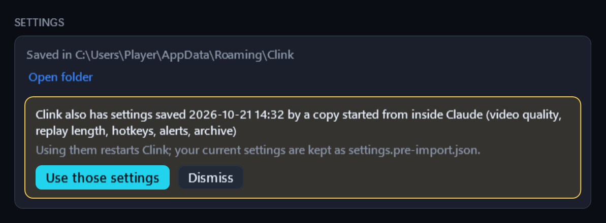</a>

Logs: `%APPDATA%\Clink\clink.log`, written only by the running Clink (a Stream Deck `--clip` that just forwards its
command does not touch it); `--selftest` / `--probe` / `--trim` write `clink-cli.log`. Each starts with a header line
(date, process id, arguments) and marks every new day; once a log passes a few MB it moves to `clink.prev.log`
(`clink-cli.prev.log`), so the two files together stay under about 8 MB.

## Building

* .NET 10 SDK (`build.ps1` also finds a user-local SDK in `%USERPROFILE%\.dotnet`).
* `.\build.ps1` → a Release build in `Clink\bin\Release\net10.0-windows10.0.26100.0\win-x64\` (`-Configuration Debug`
  for a debug one, `-Run` to start it). `.\build.ps1 -Publish` → `dist\Clink.exe` (single file, needs the .NET 10 Desktop
  Runtime on the target machine; add `-p:SelfContained=true` to the publish for a runtime-free but ~70 MB exe).
* No native dependencies. Win32/COM is reached through CsWin32-generated bindings (`NativeMethods.txt`), Windows
  Graphics Capture through the built-in WinRT projection.

### Testing

* `Clink.exe --unittest [filter]` runs the in-exe unit tests (`Clink\Tests`: static methods marked `[UnitTest]`, found by
  reflection, so there is no test framework to restore). It prints `PASS` / `FAIL` / `SKIP` per test and a summary
  (*N passed, M failed, K skipped*), runs only the tests whose `Class.Method` name contains `filter` (case ignored), and
  exits 0 when none failed (1 when a test failed, or the filter matched nothing). A test that needs a Windows feature this
  machine lacks (the audio mix render tests need Media Foundation's AAC encoder) is skipped, and counted apart, rather
  than failed; with the environment variable `CLINK_TESTS_NO_SKIP=1` a skip is a failure, which is how a machine that is
  meant to have everything runs them so that nothing is skipped by accident. `--unittest` never touches
  `%APPDATA%\Clink`, the single-instance mutex or the control pipe, so it is safe next to a running Clink. `Clink.exe` is
  a GUI-subsystem exe: from PowerShell use `Start-Process .\Clink.exe '--unittest' -Wait -PassThru -NoNewWindow` to see
  the output and get the exit code. CI does exactly that after the Release build ([`build.yml`](.github/workflows/build.yml),
  which first logs the runner's Windows build and Media Foundation file versions) and fails the job on a non-zero exit
  code. It sets `CLINK_TESTS_NO_SKIP=1`: the runner image has the AAC encoder, so a skip there would mean the mix tests
  had been switched off. `CLINK_EMULATE_ELST=1` runs the tests on a PC as on a Media Foundation that applies the audio edit
  lists of an MP4, which is what the CI runner (Windows Server 2025) has (`Clink\Tests\EditListEmulation.cs`).
* `Clink.exe --dev [folder] [--dev-hotkeys] [--dev-record] [--dev-token]` (hidden; `--dev=<folder>` works too) starts a
  **second Clink next to the real one**, for trying a build out. It has its own data folder (settings, clip index, log
  and clips; `%TEMP%\clink-dev` when no folder is given), its own single-instance mutex and control pipe (named from the
  folder, so `--clip` or `--show` aimed at it never reach the real Clink and two dev folders never meet), a **TEST marker**
  (a 3 px yellow frame and a "TEST · folder" badge on the main window, "Clink TEST (folder)" as its title, "TEST ·" in the
  tray tooltip, a yellow TEST tag and frame on toasts, " [TEST]" on the titles of its other windows), no updater (the Updates card says *updates are off in dev mode*) and no Run-key writes.
  It starts **paused** (`--dev-record` records), binds **no hotkeys** (`--dev-hotkeys` binds them, and its keyboard hook
  then swallows those combos system-wide while it runs, so use other keys than the real Clink's) and has **no Copium
  token** (`--dev-token` keeps the one its settings hold). A fresh dev folder also switches the *Recording started*
  toast off. Whatever its settings file says, a dev instance is kept away from the real clips folder, archive, updates
  and account (it says what it changed in its log). Two more switches exist for testing the settings import:
  `--packages-root <folder>` (a made-up `Packages` folder, the only place a dev instance looks for another copy's
  settings; never the real one) and `--dev-accept-import` (import what is offered, once).
  **`--dev` is the only safe way to run a second Clink.** A plain second `Clink.exe` does not start another copy: it
  hands its command (`--clip`, `--share-last`, `--trim-last`, or just *show*) to the Clink that is running and exits, so
  a test run that forgets `--dev` acts on your live session.
  * **The dev folder must be a leaf Clink can own**: new, empty, or one an earlier dev run made (an existing folder that
    holds other files and no Clink data is refused). A dev instance treats everything in its folder as its own (its
    clips are listed, trimmed, shared, archived and deleted from there), so it is refused, with exit code 2 before
    anything starts, for: the real settings folder or any folder that holds it (`%APPDATA%`, say);
    anything under `%LOCALAPPDATA%\Packages` or whose real path is a packaged app's private AppData (a junction or
    symbolic link is followed); the real clips folder (the saved `ClipsFolder` of the real settings.json, and
    `Videos\Clink`) or the real archive folder, or a parent of either; the real Clink's local data folder; a drive root;
    and the user profile folder.
  * **A mistyped switch is an error, never a normal start** (a normal start would take the real Clink's mutex or forward
    to it): an unknown `--dev…` switch, one without `--dev`, `--dev` twice, `--dev=` with nothing. Every argument is read
    as a person would (invisible characters dropped, an en or em dash or any other dash read as `-`, blanks, leading
    dashes, slashes and quotes stripped), and anything that then starts with `dev` or `packages-root` must be exactly one
    of the switches: `-dev`, `---dev`, `/dev`, `—dev` and `" --dev"` are errors. A dash, or a name that looks like a dev
    switch, after `--dev` is another switch and never its folder. The message shows the argument with anything that is
    not plain ASCII as `\uXXXX`, so a lookalike dash can be told from a hyphen. A restart (an import, an update) carries
    `--dev <folder>` and its flags again.
* `--selftest` prints where the settings are read from, and says so when this process sees a packaged app's private
  copy of AppData (see [Settings](#settings)).

### Releasing

Releases are built by GitHub Actions ([`.github/workflows/release.yml`](.github/workflows/release.yml)), not on a
dev machine, so the published exe always corresponds to a tag. Every push to `main` (and every pull request) is also
compiled by [`build.yml`](.github/workflows/build.yml), which then runs the unit tests (`--unittest`, see
[Testing](#testing)).

* **First time**: `.\tools\publish-repo.ps1` creates the GitHub repository (public by default; the updater reads
  releases anonymously, so it needs to be public), pushes `main` and prints what to do next. It needs Git and the
  GitHub CLI: `winget install --id Git.Git -e`, `winget install --id GitHub.cli -e`, then `gh auth login`.
* **Each release**: `.\tools\release.ps1 -Version 0.2.0 [-Message "what changed"]`. The script checks that the
  working tree is clean and the tag is new, sets `<Version>` in `Clink\Clink.csproj`, commits `Release v0.2.0`,
  creates the annotated tag `v0.2.0` and pushes both (`git push origin HEAD --follow-tags`). The workflow then runs
  `dotnet publish -p:Version=0.2.0 -p:UpdateRepo=<owner>/<repo>`, writes `Clink.exe.sha256` and creates the release
  "Clink v0.2.0" with generated notes and both files attached. Running copies of Clink see it within 6 hours.
* The asset names matter: the updater downloads the asset called exactly `Clink.exe` and checks it against the first
  64-hex token of `Clink.exe.sha256`; a release without the `.sha256` file is refused. The exe must also report the
  version of its tag (the workflow guarantees this with `-p:Version`), or the updater throws it away. `UpdateRepo`
  tells the exe which repository's releases to watch, so only exes built by the workflow (or a local publish with
  the same `-p:UpdateRepo=...`) download or install updates; a plain debug build ignores the shared updates folder.
* A version with a `-` suffix (`0.2.0-beta.1`) is published as a pre-release, which the updater ignores; a build of
  that pre-release does pick up the final `0.2.0` when it ships. To redo a failed release, delete the tag
  (`git tag -d v0.2.0; git push origin :refs/tags/v0.2.0`) and run the script again. Running the workflow by hand
  refuses a version that is already tagged.
* The workflow's actions are pinned to commit SHAs and `.github/dependabot.yml` opens PRs to bump them: whatever code
  runs in that job can publish a release, so a floating tag would be a way in.

### How it works (short)

```
monitor ──WGC (BGRA8 or FP16 scRGB)──► latest frame texture
                                            │ 60 Hz pacer
                                   compute shader: scale, tone-map, BT.709 → NV12
                                            │
                                   hardware encoder MFT (async) ──► ring buffer of compressed frames (RAM)
WASAPI loopback / mic / process loopback ──► per-track timeline (silence-filled) ──► AAC ──► ring of frames
                                            │ hotkey
                                   snapshot both rings from the last keyframe ──► own MP4 muxer (fast-start)
```

Timestamps everywhere are QPC-based 100 ns units, which is what WGC and WASAPI both report, so video and the
audio tracks line up without guesswork. Clips are muxed by Clink's own small ISO-BMFF writer (one video track,
N AAC tracks with names, edit lists for sub-frame alignment).

See [ROADMAP.md](ROADMAP.md) for what's next.

Clink is made by Euphoric Software.
